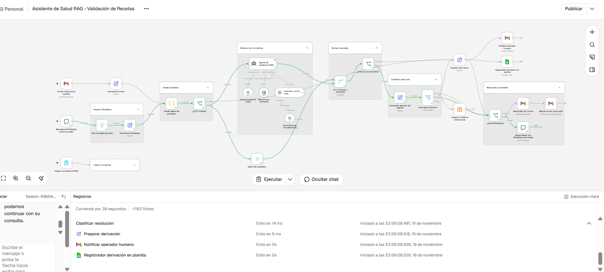
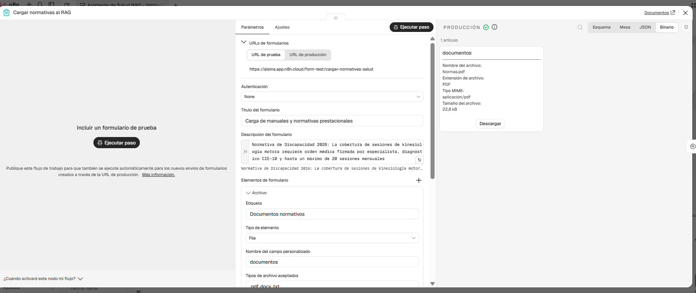

# Asistente Inteligente con RAG y Automatización para la Validación de Recetas y Prestaciones Médicas (Discapacidad)

Proyecto Final: flujo de n8n que recibe consultas de prestadores de salud por correo institucional y WhatsApp, valida los datos del prestador, consulta normativas con RAG y decide si **aprueba**, **rechaza por formato inválido** o **deriva a un operador humano**.

## 1. Problema y objetivo

| Indicador | Situación actual | Objetivo |
|---|---|---|
| Casos diarios | 60 | 60 |
| Trabajo manual | 4,5 h/día | Reducción del 80 % |
| Carga semanal | 22,5 h/semana | Ahorro de 18 h/semana |

El área de discapacidad valida a mano recetas, órdenes médicas y coberturas contra manuales, vademécums y normativas. El asistente automatiza la clasificación y deja a las personas solo los casos dudosos.

## 2. Arquitectura

```
Correo institucional (Gmail) ─┐
                              ├─> Normalizar ─> Validar datos del prestador (CUIT mod-11)
WhatsApp (chat simulado) ─────┘                         │
                                          ¿CUIT inválido? ──sí──> Derivación humana
                                                        │no
                                        Agente de validación (RAG)
                                   (LLM + memoria + consultar_normativas)
                                                        │
                                        ¿Falló la consulta RAG? ──sí──> Derivación humana (fallback)
                                                        │no
                                        Interpretar decisión del agente
                                                        │
                                Ruta según decisión: APROBADO / RECHAZADO / DERIVAR
                                   │                 │                 │
                     Cargar en sistema        Responder al      Notificar operador (Gmail)
                     (Data Table)             prestador         + Registrar en planilla (Google Sheets)
                                                                + Responder al prestador

Formulario "Cargar normativas al RAG" ─> Leer documentos ─> Dividir en fragmentos ─> Embeddings ─> Vector Store
```

### Componentes

| Componente | Nodo n8n | Función |
|---|---|---|
| Entrada correo | Gmail Trigger | Lee correos nuevos del buzón institucional |
| Entrada WhatsApp | Chat Trigger (simulado) | Simula los mensajes de WhatsApp Business desde el chat de n8n |
| Validación | Code | Extrae CUIT y n° de afiliado, valida el dígito verificador del CUIT (módulo 11) |
| Agente | AI Agent | Aplica el System Prompt y decide la resolución |
| LLM | Ollama Chat Model (`llama3.1:8b`) | Modelo local, por privacidad de datos de salud |
| Memoria | Window Buffer Memory | Contexto por remitente (6 mensajes) |
| RAG | Simple Vector Store (retrieve-as-tool) + Ollama Embeddings (`nomic-embed-text`) | Busca fragmentos en manuales, vademécums y normativas (top 5) |
| Ingesta | Form Trigger + Default Data Loader + Recursive Text Splitter | Carga PDF/DOCX/TXT al RAG (fragmentos de 1000 caracteres, solapamiento 150) |
| Persistencia | Data Table `prestaciones_validadas` | Registra los casos aprobados |
| Derivación | Gmail + Google Sheets ("Derivaciones de SaludBOT") | Avisa al operador y deja el caso como `pendiente` |

## 3. Mensaje del sistema

Texto configurado en el nodo *Agente de validación (RAG)* (*Opciones > Mensaje del Sistema*):

```text
Actúa como el asistente virtual oficial de validación de recetas, órdenes médicas y atención a prestadores de salud en el área de discapacidad. Tu objetivo es guiar al profesional, verificar normativas de cobertura utilizando exclusivamente la base de conocimiento recuperada (RAG) y clasificar las solicitudes con estricto rigor administrativo.

[HERRAMIENTAS]
- consultar_normativas: búsqueda vectorial sobre manuales de prácticas, vademécums y normativas prestacionales vigentes. Debes llamarla SIEMPRE antes de responder sobre coberturas, recetas, vademécum o validación de prácticas.

[REGLAS Y RESTRICCIONES]
- Utiliza estrictamente la información obtenida a través de la herramienta consultar_normativas para responder dudas sobre vademecums, normativas de recetas o validación de prácticas médicas.
- PROTOCOLO PARA RESPUESTAS DESCONOCIDAS: Si la información no se encuentra en el contexto recuperado o en tus bases de datos, tienes prohibido inventar o especular. Debes responder textualmente: "No dispongo de esa información en los manuales prestacionales vigentes. Por favor, indíqueme su CUIT y el número de afiliado para derivar su consulta a un operador humano."
- Mantén un tono profesional, claro, empático y conciso, optimizado para canales de mensajería rápida como WhatsApp.
- Evalúa el caso y determina si requiere derivación humana inmediata ante incongruencias normativas, recetas vencidas o datos incompletos.

[FORMATO DE SALIDA OBLIGATORIO]
- Redacta primero la respuesta para el prestador (máximo 900 caracteres).
- En la ÚLTIMA línea escribe exactamente una de estas etiquetas:
  DECISION: APROBADO  -> receta u orden completa, vigente, con CUIT y número de afiliado informados y cobertura confirmada por el contexto recuperado.
  DECISION: RECHAZADO -> error de formato que el prestador puede corregir (indica qué debe corregir).
  DECISION: DERIVAR   -> información no encontrada en los manuales, incongruencias normativas, recetas vencidas, datos incompletos o dudas médico-legales.
- Si dudas entre dos decisiones, elige DERIVAR.
```

## 4. Manejo de errores

| Situación | Comportamiento |
|---|---|
| CUIT con dígito verificador inválido (módulo 11) o prefijo inexistente | Derivación humana directa, sin pasar por el agente; **no** se inserta en la base |
| CUIT ausente en el mensaje | El agente pide CUIT y número de afiliado (protocolo de respuesta desconocida) o deriva; nunca aprueba sin CUIT |
| Falla o timeout del Vector Store / LLM | El agente continúa con salida de error (`onError: continueRegularOutput`); el If "¿Falló la consulta RAG?" envía el caso a derivación (fallback) |
| Respuesta del agente sin etiqueta de decisión | Se trata como `DERIVAR` |
| Formato de receta corregible | `RECHAZADO`: se responde al prestador indicando qué corregir, sin insertar |

## 5. Datos

**Data Table `prestaciones_validadas`:** canal, remitente, cuit_prestador, numero_afiliado, mensaje_original, resolucion, respuesta_agente, procesado_en.

**Google Sheets "Derivaciones de SaludBOT":** fecha, nombre, matricula_o_cuit, telefono, motivo, resumen, estado.

## 6. Instalación

1. Importar `workflow-asistente-salud-rag.json` en n8n (menú **⋯ > Import from file**).
2. Configurar credenciales: Gmail OAuth2, Google Sheets OAuth2 y Ollama.
3. Instalar Ollama (https://ollama.com/download) y descargar los modelos: `ollama pull llama3.1:8b` y `ollama pull nomic-embed-text`.
4. Si n8n corre en la nube, exponer Ollama con un túnel y usar esa URL (https://…) como Base URL de la credencial Ollama:
   - ngrok: `ngrok http 11434 --host-header="localhost:11434"`
   - Cloudflare: `cloudflared tunnel --url http://localhost:11434 --http-host-header="localhost:11434"`
5. Completar el correo del operador en **Notificar operador humano**.
6. Publicar el workflow y cargar los manuales desde el formulario `/form/cargar-normativas-salud`.
7. Probar con el botón **Open chat** del canvas.

## 7. Evidencias de ejecución

### Canvas completo




### Ejecución exitosa con RAG



Caso de prueba: se cargó un manual prestacional desde el formulario y se envió por el chat una orden con CUIT válido y número de afiliado. El agente consultó `consultar_normativas`, citó el fragmento recuperado y emitió la decisión.

### Pruebas realizadas

| Prueba | Entrada | Resultado esperado |
|---|---|---|
| CUIT inválido | `20-12345678-9` | Derivación humana directa, sin inserción |
| Ollama no disponible | CUIT válido, LLM caído | Fallback a derivación con aviso al prestador |
| Caso con cobertura en el manual | CUIT `20-12345678-6`, afiliado `123456/01` | `APROBADO` → carga en `prestaciones_validadas` → respuesta al prestador |
| Consulta fuera de los manuales | Pregunta no cubierta | Respuesta de protocolo y `DERIVAR` |

**Nota:** WhatsApp Business se simula con el chat integrado de n8n (Chat Trigger). La lógica posterior es idéntica a la de un mensaje real.

## 8. Retorno de la inversión (ROI)

> Todos los valores monetarios son **supuestos** de referencia en dólares (USD), a ajustar con datos reales de la institución.

**Ahorro**

| Concepto | Cálculo | Valor |
|---|---|---|
| Carga manual actual | 4,5 h/día × 5 días | 22,5 h/semana |
| Horas ahorradas (80 %) | 22,5 × 0,8 | 18 h/semana ≈ 78 h/mes |
| Costo hora analista administrativo (supuesto) | — | USD 8 |
| **Ahorro mensual** | 78 h × USD 8 | **USD 624** |

**Costos**

| Concepto | Supuesto | Valor |
|---|---|---|
| Desarrollo e implementación | 60 h × USD 15/h | USD 900 (única vez) |
| n8n (plan cloud básico) | aprox. | USD 24/mes |
| Servidor Ollama (equipo propio, energía y mantenimiento) | aprox. | USD 16/mes |
| **Costo mensual de operación** | | **USD 40** |

**Resultado**

| Indicador | Cálculo | Valor |
|---|---|---|
| Beneficio neto mensual | 624 − 40 | USD 584 |
| Recupero de la inversión | 900 / 584 | ≈ 1,5 meses |
| Costo total del primer año | 900 + 40 × 12 | USD 1.380 |
| Ahorro del primer año | 624 × 12 | USD 7.488 |
| **ROI primer año** | (7.488 − 1.380) / 1.380 | **≈ 443 %** |

Además del ahorro monetario, el sistema estandariza criterios, deja trazabilidad de cada resolución y libera al equipo para los casos complejos.

## 9. Decisiones técnicas y limitaciones

- **Llama 3.1 en lugar de Llama 3:** Llama 3 no soporta herramientas en Ollama, y el agente necesita llamar a `consultar_normativas`.
- **Privacidad:** el modelo local evita enviar datos de salud a terceros. Con n8n Cloud, Ollama debe quedar expuesto a internet; para producción se recomienda n8n self-hosted en la misma red que Ollama.
- **Vector Store en memoria:** se pierde al reiniciar n8n. Para producción conviene Qdrant o PGVector.
- **WhatsApp:** simulado. Para producción se reemplaza el Chat Trigger por el WhatsApp Trigger y el nodo de envío de WhatsApp Business Cloud.

## 10. Estructura del repositorio

```text
/
├── workflow-asistente-salud-rag.json   # Workflow exportado desde n8n (⋯ > Download)
├── README.md
└── capturas/
    ├── canvas-completo.png
    └── ejecucion-rag-exitosa.png
```
